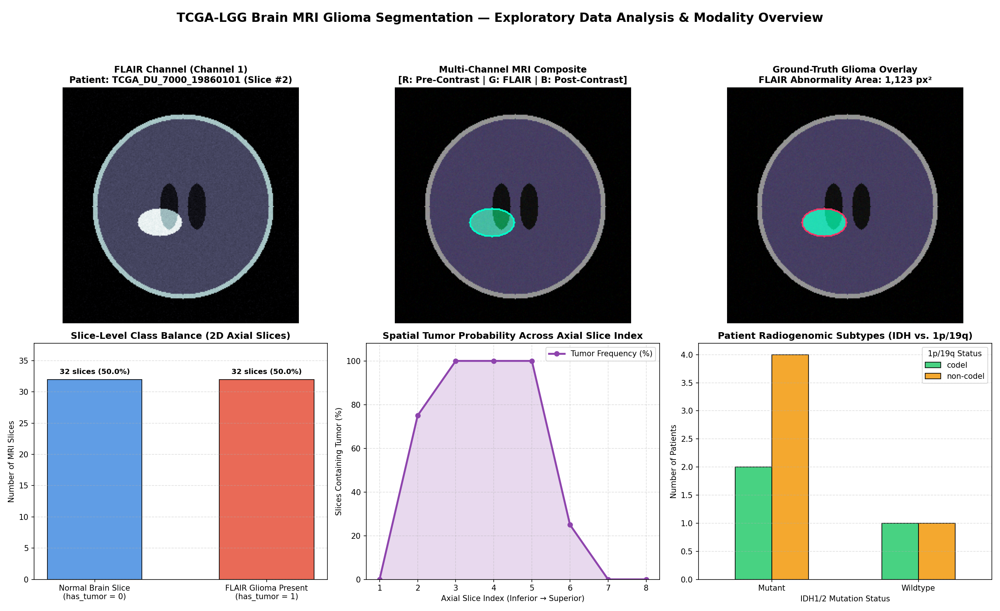

# 🚀 GlioRad Starter Code: Glioma MRI Segmentation

This directory contains starter materials to help you visualize multi-modal brain MRI scans, build a segmentation model, and encrypt your competition submission for the **GlioRad Challenge**.



## Files
- `visualize_data.py`: Exploratory Data Analysis (EDA) & MRI slice visualization script that plots Pre-contrast, FLAIR, and Post-contrast channels, ground-truth tumor overlays, slice-level class balance, axial tumor progression, and radiogenomic subtype distributions (`eda_tcga_lgg_overview.png`).
- `baseline.py`: Trainable starter baseline script producing `submissions/baseline_submission.csv` with RLE masks.
- `encrypt.py`: Utility script to encrypt your submission file using the official RSA public key.
- `public_key.pem`: Challenge public key for submission encryption.
- `requirements.txt`: Python package requirements.

## Quick Start
```bash
# 1. Install dependencies
pip install -r starter_code/requirements.txt

# 2. Visualize the MRI dataset & generate EDA overview plot
python starter_code/visualize_data.py

# 3. Run the baseline model
python starter_code/baseline.py

# 4. Encrypt your submission
python starter_code/encrypt.py submissions/<team_name>.csv

# 5. Commit and submit PR
git add submissions/<team_name>.csv.enc
git commit -m "Submit encrypted predictions for <team_name>"
git push origin <your-branch>
```
